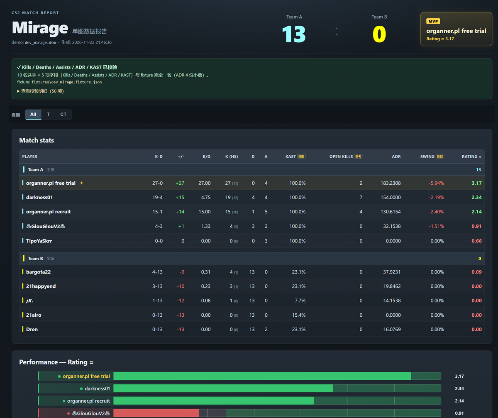

# CS2 Stats Report

**自动监听 CS2 GOTV Demo，生成 HLTV 风格的 HTML 对局数据报告。**  
Windows 一键运行 · 无需安装 Python · 单文件 HTML 离线可看



## 这是什么

`CS2Stats` 是一个 Windows 小工具：开启 GOTV 录制后，双击程序，选择 CS2 的 demo 输出目录，程序会监听新生成的 `.dem`。一局结束后，它自动解析 demo，并弹出类似 HLTV mapstats 的 HTML 报告。

它适合：

- 和朋友在本地服务器打完一局，想快速复盘；
- 没有上传到第三方平台，想在本地保留一份可分享的对局报告；
- 想把 K/D/A、ADR、KAST、首杀、击杀矩阵、雷达图放进同一个页面。

## 主要功能

- **自动监听**：监听 `<CS2>\game\csgo\replays\`，文件大小稳定后解析，自动打开报告。
- **手动模式**：也可以直接选择一个已有 `.dem`。
- **Match Stats**：K-D、+/-、K/D、K(HS)、D、A、KAST、Open Kills、ADR、Swing、Rating，支持 All / T / CT 切换。
- **Performance Rating**：十名选手按 Rating 全局排序，三档颜色（优 / 中 / 差）。
- **Kill Matrix**：事件层可靠时显示，逐条统计击杀者 → 被击杀者；不可靠时隐藏并说明原因。
- **Player Performance**：目标选手的六维雷达图 + 与全场平均的对比条形图。
- **MVP**：头部展示本场 Rating 最高的获胜方选手。
- **离线单文件**：Chart/ECharts、CSS、数据全部内嵌，不需要联网。

## 快速开始（Windows）

1. 下载 `CS2Stats-1.1.0-onedir.zip`，完整解压。
2. 进入 `CS2Stats-1.1.0-onedir`，双击 `CS2Stats\CS2Stats.exe`。
3. 第一次启动会自动生成 `stat.cfg`，并尝试复制到 CS2 的 `game\csgo\cfg`。
   - 如果已有 `stat.cfg`，程序不会覆盖，会改名为 `stat_cs2stats.cfg`。
   - 如果自动定位失败，程序会让你选择 `game\csgo\cfg` 目录。
4. 打开 CS2 控制台，**在地图加载之前**执行：

   ```text
   exec stat
   ```

   如果程序提示复制的是 `stat_cs2stats.cfg`，则执行：

   ```text
   exec stat_cs2stats
   ```

   然后加载地图：

   ```text
   map de_mirage
   ```

   `tv_enable 1` / `tv_autorecord 1` 必须在地图加载前生效；中途设置对当前地图无效。

5. 在程序里确认 demo 目录为：

   ```text
   <CS2 安装目录>\game\csgo\replays
   ```

6. 开始监听。对局结束后，报告会写到程序根目录的：

   ```text
   output\report_<地图>_<时间戳>.html
   ```

   并自动用默认浏览器打开。

> onedir 版本中，`stat.cfg`、`settings.json`、`output\` 都在 `CS2Stats-1.1.0-onedir\` 根目录（exe 的上一级）。  
> onefile 版本则在 exe 同目录。

## 手动解析已有 demo

```powershell
.\CS2Stats\CS2Stats.exe "D:\demos\my_match.dem"
```

可选：

```powershell
.\CS2Stats\CS2Stats.exe "D:\demos\my_match.dem" --fixture .\fixtures\user_mirage_20261122.fixture.json
```

## 数据口径（重要）

这个项目把数据分成四层，HTML 底部也会写明：

| 层级 | 字段 | 来源 | 说明 |
|---|---|---|---|
| 精确层 | Kills / Deaths / Assists / ADR | `demoparser2` 计分板属性 | 已用同一场计分板截图 fixture 逐项校验；ADR 按截图的“伤害/局”向下取整 |
| 计分板读取 | K(HS) | `headshot_kills_total` | 计分板有值，但截图只有爆头率，未逐项 fixture 校验 |
| 推断层 | KAST、Open Kills、Swing | 逐回合 K/A/S/D 差分 | 明确标“推断/参考”，不宣称与 HLTV 完全一致 |
| 事件层 | Kill Matrix、A(f)、D(t) | `player_death` / 回合事件 | 若 demo 存在 bot 接管等导致事件归因错乱，会隐藏矩阵并说明 |
| 近似层 | Rating / Swing / MVP | 自定义近似公式 | **非 HLTV 官方数值**，不可用于与 HLTV 页面逐位比对 |

已知限制：

- 当前 demo 出现 bot 接管时，`player_death` 的 attacker/victim 归因会错位；程序会自动切换到计分板属性作为精确层，并隐藏不可靠的事件层。
- KAST 不含 traded 回合；截图没有 KAST 列，无法 fixture 校验。
- 报告仅针对单张地图；不做跨图汇总。
- 目标选手默认 `Beneqin1`，找不到时会回退到全场 Rating 最高的选手，并在报告中提示。

详细口径、FAQ、杀软误报处理、换 awpy 版本等内容见 [README.txt](README.txt)。

## 从源码运行

需要 Python 3.12。

```powershell
python -m venv .venv
.\.venv\Scripts\python.exe -m pip install -r requirements.txt
.\.venv\Scripts\python.exe run_app.py
```

命令行：

```powershell
.\.venv\Scripts\python.exe run_app.py --watch
.\.venv\Scripts\python.exe run_app.py "D:\demos\match.dem" --fixture .\fixtures\user_mirage_20261122.fixture.json
```

校验：

```powershell
.\.venv\Scripts\python.exe validate_stats.py "D:\demos\match.dem" .\fixtures\user_mirage_20261122.fixture.json
```

## 构建 exe

```powershell
powershell.exe -NoProfile -ExecutionPolicy Bypass -File .\build_exe.ps1
```

默认构建 onedir：

```text
package\CS2Stats-1.1.0-onedir\
dist\CS2Stats-1.1.0-onedir.zip
```

## 项目结构

```text
cs2stats/
  demo_parser.py       # awpy demo 读取、正式回合过滤、事件重建
  scoreboard.py        # demoparser2 计分板属性层与降级逻辑
  validation.py        # fixture 校验、ADR 取整
  report_data.py       # 报告 JSON 数据
  rating.py            # 近似 Rating / Swing
  templates/           # Jinja2 单文件报告
  gui.py               # Tkinter GUI
  demo_watch.py        # demo 文件夹监听
  first_run.py         # stat.cfg / 首次运行
  paths.py             # output、settings 路径
  cli.py
run_app.py
validate_stats.py
fixtures/
docs/
```

## 开发者

当前版本：**1.1.0**。变更见 [CHANGELOG.txt](CHANGELOG.txt)。

如果要在本项目基础上继续改进，建议先阅读 **[NEXT_MODEL_PROMPT.md](NEXT_MODEL_PROMPT.md)**：它记录了数据管线、不可破坏的约束、已知坑和验收命令。

## 致谢与许可

- Demo 解析：[awpy](https://github.com/pnxenopoulos/awpy)、[demoparser2](https://github.com/LaihoE/demoparser)
- HTML 图表：[ECharts](https://echarts.apache.org/)
- 布局参考：HLTV match stats / player performance 页面

项目暂未指定开源许可证。公开分发或商用前请先联系作者确认。
